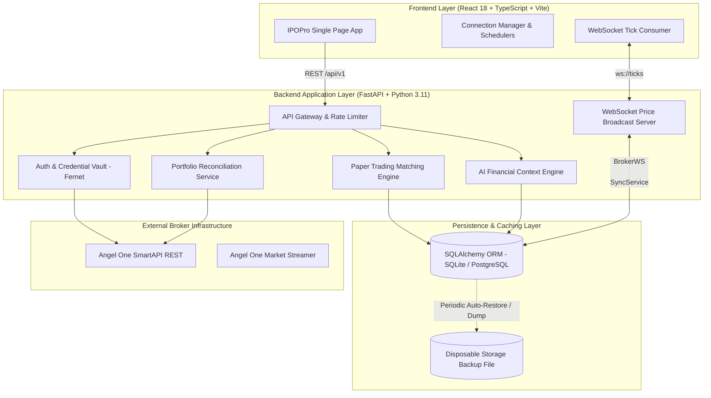
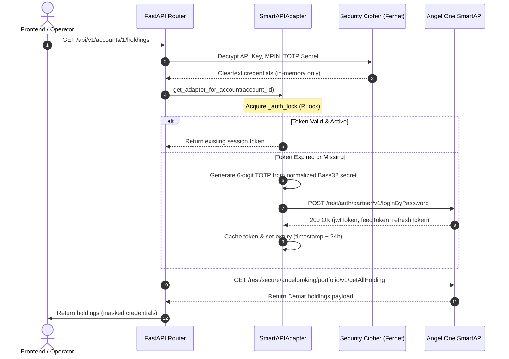

# IPOPro — Architecture & Data Flow Specification

This document details the complete end-to-end software architecture, data flow paths, session lifecycle, and concurrency model of the IPOPro application.

---

## 1. High-Level Architectural Diagram

---

## 2. Authentication & Session Concurrency Flow

Angel One SmartAPI requires:
- `api_key`
- `client_code`
- `pin` (MPIN)
- `totp` (6-digit time-based one-time password generated from a Base32 secret)

### Thread-Safe Session Concurrency Model
To prevent race conditions during simultaneous API calls across multiple Demat accounts:
1. **Adapter Cache Lock (`threading.Lock`):**
   - Access to the in-memory adapter cache dictionary `_adapter_cache` is serialized with `_adapter_lock`.
2. **Re-entrant Session Lock (`threading.RLock`):**
   - Each `SmartAPIAdapter` instance encapsulates a dedicated `_auth_lock = threading.RLock()`.
   - `_ensure_authenticated()` acquires `_auth_lock` and inspects token expiration timestamp.
   - If token is missing, expired, or invalidated (`is_session_expired = True`), it invokes `self.authenticate()`, which safely re-enters the same lock without deadlocking.
3. **Session Re-use:**
   - Active JWT tokens are cached and re-used across requests until within 300 seconds of broker expiration, minimizing redundant login round-trips.

---

## 3. Real-Time Price Streaming & P&L Calculation

1. **Broker Tick Streaming:**
   - The backend maintains an asynchronous connection to Angel One WebSocket servers or generates synchronized simulation ticks in Paper mode.
2. **Fan-Out via Local WebSocket:**
   - Connected browser clients open a persistent WebSocket channel at `/api/v1/market/ws`.
   - Ticks containing `symbol_token`, `last_traded_price`, and `timestamp` are broadcast to all subscribers.
3. **Frontend Calculation Engine (`PortfolioView.tsx`):**
   - When a tick is received for an active holding, the client updates the prevailing LTP in memory.
   - The current market value (`allotted_quantity * current_ltp`) and unrealized P&L (`current_market_value - total_investment`) are recomputed instantly in pure JavaScript.
   - Total portfolio valuation, day change, and overall returns update continuously without page reloads.

---

## 4. Rate Limiting & Protection Layers

1. **FastAPI Rate Limiting (`SlowAPI` / Token Bucket):**
   - Critical operational endpoints (e.g. `/orders/single`, `/orders/bulk-execute`, `/accounts/{id}/reconnect`) are rate-limited to 30 requests per minute per IP to prevent broker rate-limit penalties.
2. **Emergency Trading Halt:**
   - A global kill switch stored in `RiskLimit` can be engaged at any time. When active, all order execution endpoints reject orders immediately with an explicit halt notice.
3. **Retail Application Capping:**
   - IPO application builders enforce the SEBI ₹200,000 retail investment ceiling across Demat accounts, blocking bids that exceed statutory thresholds.
