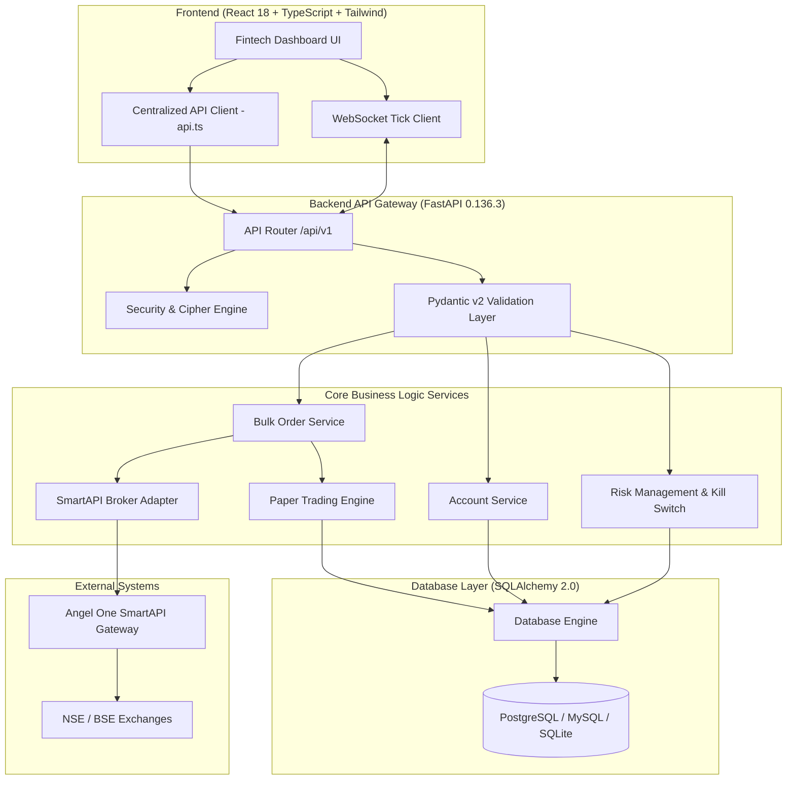
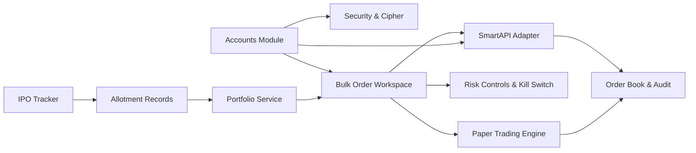

# IPOPro — System Documentation: Project Overview

---

## 1. Executive Summary & Product Overview

### 1.1 Product Mission
**IPOPro** is a specialized fintech multi-account IPO monitoring, portfolio management, and order-orchestration platform tailored specifically for Indian capital markets (NSE and BSE).

In the Indian IPO ecosystem, retail and HNI investors frequently apply for Initial Public Offerings across multiple family and associate Demat accounts (e.g., self, spouse, parents, HUF) to maximize allotment probabilities under the SEBI proportional and lottery allotment guidelines. 

On the listing morning (specifically during the pre-open auction between 09:00 AM and 09:45 AM IST, and at open market at 10:00 AM IST), retail traders face severe execution bottlenecks:
- Logging into 5 to 20 individual broker accounts or mobile apps simultaneously.
- Manually verifying which accounts received allotments from registrars (Link Intime, KFintech, Bigshare).
- Manually calculating exit quantities, setting price limits, and placing individual exit sell orders across disparate accounts within minutes.
- Coping with sudden market volatility, price gaps, and accidental duplicate submissions.

IPOPro solves these problems by providing:
1. **Centralized Multi-Account View**: Secure aggregation of multiple Angel One accounts with independent session tokens.
2. **Consolidated IPO Tracker & Allotment Register**: Unified tracking of upcoming, pre-open, and listed IPOs with manual or CSV-based allotment reconciliation.
3. **Pre-Flight Bulk Order Orchestrator**: A two-phase bulk-selling workspace that validates physical Demat holding balances, tick sizes, and risk limits before preparing and executing rate-limited limit orders across authorized accounts.
4. **Market Rule Compliance Engine**: Dedicated support for Indian market rules (e.g., pre-open sessions accept only LIMIT orders; tick size ₹0.05; Demat delivery verification).
5. **Emergency Kill Switch & Risk Controls**: Instant server-side trading halt and account-level exposure limits.
6. **Isolated Paper Trading Sandbox**: Full execution simulation engine with zero risk of live capital loss during testing.

### 1.2 Target User Profiles
- **Multi-Account Retail & HNI IPO Investors**: Investors managing family portfolios seeking rapid, coordinated exit execution on listing day.
- **Family Office Operators**: Portfolio managers monitoring allotment status and aggregate unrealized gains across multiple family Demat accounts.
- **Fintech Engineers & Algorithmic Traders**: Developers deploying automated pre-open trading strategies against Angel One SmartAPI infrastructure.

### 1.3 Intended Product vs. Actual Implementation Status

| Feature / Subsystem | Intended Vision | Actual Codebase Implementation | Verification Status |
| :--- | :--- | :--- | :--- |
| **Multi-Account Aggregation** | Single dashboard for 50+ broker accounts | Implemented via `BrokerAccount` model, AES-256 storage, and 1:1 SmartAPI connector. | **Implemented & Verified** |
| **Credential Security** | Zero-plaintext credential exposure | AES-256 Fernet encryption, client ID masking (`A***345`), and log scrubbing. | **Implemented & Verified** |
| **IPO Lifecycle Tracking** | Upcoming, Pre-Open, Listed IPO status tracking | Supported via `IPO` model, REST routes, and responsive UI cards. | **Implemented & Verified** |
| **Allotment Data Ingestion** | Automated registrar scraping & CSV upload | CSV import and manual entry implemented; automated registrar scraping unavailable due to lack of public APIs. | **Partially Implemented (CSV/Manual)** |
| **Market Data Streaming** | Real-time WebSocket ticks from Angel One | WebSocket server (`/api/v1/market/ws`) with price movement simulator implemented. Live Angel One SmartStream requires static IP. | **Simulated / Ready for Live** |
| **Bulk Order Preparation** | Pre-flight validation, draft preview, and execution | Two-phase pipeline in `BulkOrderService`: holding check -> preview -> rate-limited execution. | **Implemented & Verified** |
| **Pre-Open Market Rules** | Strict LIMIT order enforcement during 09:00-09:45 AM | Enforced in `PaperTradingService` and `BulkOrderService` (market orders rejected). | **Implemented & Verified** |
| **Risk Limits & Kill Switch** | Server-side halt and order value limits | Emergency kill switch toggles order queues instantly; max order value verified. | **Implemented & Verified** |
| **Live Order Placement** | Automated execution on Angel One exchange | Implemented in `SmartAPIAdapter`. Live placement requires user static IP registration on SmartAPI. | **Awaiting Broker Setup** |

---

## 2. System Architecture & Component Mapping

### 2.1 Repository Directory Structure
```
d:/ANGLE ONE/
├── backend/
│   ├── alembic/                      # Database migration versions and config
│   │   ├── versions/
│   │   │   └── 5d4ab2042af6_initial_schema.py
│   │   └── env.py
│   ├── app/
│   │   ├── api/                      # REST & WebSocket API Routers (/api/v1)
│   │   │   ├── api_v1.py             # Router aggregator
│   │   │   ├── endpoints_accounts.py # Account registration, CRUD & auth tests
│   │   │   ├── endpoints_audit.py    # System KPI summaries & audit logs
│   │   │   ├── endpoints_health.py   # Liveness & readiness probe
│   │   │   ├── endpoints_ipos.py     # IPO management & CSV allotment upload
│   │   │   ├── endpoints_market.py   # Quotes & WebSocket tick stream
│   │   │   ├── endpoints_orders.py   # Single & bulk order execution routes
│   │   │   ├── endpoints_portfolio.py# Aggregated & per-account holdings
│   │   │   └── endpoints_risk.py     # Risk limits & Emergency Kill Switch
│   │   ├── core/                     # Foundational infrastructure
│   │   │   ├── config.py             # Pydantic v2 application settings
│   │   │   ├── database.py           # SQLAlchemy multi-database engine
│   │   │   └── security.py           # AES-256 Fernet cipher & RFC 6238 TOTP
│   │   ├── models/                   # SQLAlchemy ORM database models
│   │   │   ├── account.py            # BrokerAccount
│   │   │   ├── audit.py              # AuditLog
│   │   │   ├── ipo.py                # IPO & IPOAllotment
│   │   │   ├── order.py              # Order & ExecutionRecord
│   │   │   └── risk.py               # RiskLimit
│   │   ├── schemas/                  # Pydantic v2 data transfer objects
│   │   │   ├── account.py
│   │   │   ├── ipo.py
│   │   │   ├── order.py
│   │   │   └── risk.py
│   │   ├── services/                 # Business logic & adapters
│   │   │   ├── bulk_order_service.py # Pre-flight validation & bulk execution
│   │   │   ├── paper_trading_service.py # Exchange-compliant simulator
│   │   │   ├── seed_data.py          # Data wiper and test fixture seeding
│   │   │   └── smartapi_adapter.py   # Official Angel One SmartAPI connector
│   │   └── main.py                   # FastAPI server entry point
│   ├── tests/                        # 14 Pytest automated test suites
│   │   ├── conftest.py               # Isolated in-memory SQLite fixture harness
│   │   ├── test_accounts.py          # Account CRUD & duplication tests
│   │   ├── test_bulk_orders.py       # Pre-flight bulk validation tests
│   │   ├── test_encryption.py        # AES-256 roundtrip & TOTP tests
│   │   ├── test_paper_trading.py     # Simulator execution & kill switch tests
│   │   └── test_risk_controls.py     # Risk threshold & KPI metric tests
│   ├── requirements.txt              # Pinned Python dependencies
│   ├── .env                          # Local environment variables
│   └── Dockerfile                    # Container definition for backend
├── frontend/
│   ├── src/
│   │   ├── components/               # Persistent navigational components
│   │   │   ├── Header.tsx            # IST clock, mode badge, session indicator
│   │   │   └── Sidebar.tsx           # Navy fintech navigation & Kill Switch
│   │   ├── views/                    # 10 dedicated functional screens
│   │   │   ├── AccountsView.tsx      # Multi-account management & auth
│   │   │   ├── AlertsView.tsx        # Audit trail & alert log table
│   │   │   ├── BulkOrderView.tsx     # Pre-flight multi-account bulk workspace
│   │   │   ├── DashboardView.tsx     # High-level portfolio & IPO KPI cards
│   │   │   ├── IPOTrackerView.tsx    # IPO registry, allotments & CSV upload
│   │   │   ├── MarketWatchView.tsx   # Live prices, depth & simulator
│   │   │   ├── OrdersView.tsx        # Order book & trade history
│   │   │   ├── PortfolioView.tsx     # Consolidated holdings & drilldown
│   │   │   ├── RiskView.tsx          # Exposure limits & trading halt controls
│   │   │   └── SettingsView.tsx      # System configuration & CSV exports
│   │   ├── api.ts                    # Centralized typed Axios client
│   │   ├── App.tsx                   # Top-level view router & WebSocket listener
│   │   ├── index.css                 # Tailwind directives & financial styling
│   │   ├── types.ts                  # Shared TypeScript interfaces
│   │   └── main.tsx                  # React DOM root
│   ├── package.json                  # Frontend dependencies
│   ├── tsconfig.json                 # Strict TypeScript configuration
│   ├── vite.config.ts                # Vite dev server & proxy setup
│   └── Dockerfile                    # Production Nginx container build
├── docs/                             # Architecture & operational manuals
│   ├── IPRO_PRO_SYSTEM_MANUAL.md     # Comprehensive operational handbook
│   └── audit/                        # Independent review audit package
├── docker-compose.yml                # Multi-service container orchestration
└── README.md                         # Quickstart guide
```

---

## 3. Technology Stack & Justification

| Layer | Technology | Version | Architectural Rationale |
| :--- | :--- | :--- | :--- |
| **Backend Framework** | FastAPI (Python) | 0.136.3 | Native asynchronous I/O, automatic OpenAPI schema generation, fast serialization with Pydantic v2. |
| **Data Validation** | Pydantic v2 | 2.12.5 | Strict runtime type validation, serialization via `.model_dump()`, explicit schema boundaries. |
| **ORM & Database Abstraction** | SQLAlchemy | 2.0.50 | Decouples business logic from physical storage engines; supports PostgreSQL, MySQL, and SQLite. |
| **Database Migrations** | Alembic | 1.18.4 | Programmatic version control for database schemas, automated migration scripts. |
| **Security & Cryptography** | Cryptography (Fernet) | 46.0.7 | Authenticated symmetric AES-256 encryption using CBC mode with HMAC-SHA256 authentication. |
| **Authentication Engine** | Pure RFC 6238 / PyOTP | Built-in | Zero-dependency standard library TOTP fallback ensuring mathematical guarantee of 2FA generation. |
| **Frontend Framework** | React | 18.2.0 | Declarative UI component state management with hooks. |
| **Frontend Language** | TypeScript | 5.2.2 | Strict compile-time typing, eliminating undefined property errors across financial contracts. |
| **Styling Engine** | Tailwind CSS | 3.4.1 | Utility-first CSS ensuring restrained fintech color palette and consistent spacing scales. |
| **Data Visualization** | Recharts | 2.12.3 | Responsive SVG-based charting for portfolio P&L and market trends. |
| **Icons Library** | Lucide React | 0.359.0 | Clean, professional stroke icons with consistent sizing and weight. |

---

## 4. High-Level Architecture Diagrams

### 4.1 Overall System Architecture


### 4.2 Module Inter-Dependency Map


---

## 5. Summary of Verified Capabilities vs. External Dependencies

1. **Independent Capabilities (Fully Functional Without External Connections)**:
   - Client credential encryption, decryption, and secure storage.
   - IPO registry, allotment record keeping, and registrar CSV ingestion.
   - Consolidated portfolio valuation across multiple family accounts.
   - Pre-flight bulk order validation (checking holding quantities, tick sizes, price limits).
   - Pre-open compliant limit order paper trading simulation.
   - Emergency Kill Switch halting order dispatches.
   - System audit trail logging and KPI summary reporting.

2. **External Capabilities Requiring Angel One Configuration**:
   - Live session token generation via TOTP (`loginByPassword`).
   - Live Demat holding fetch (`getAllHolding`).
   - Live order placement on NSE/BSE equity segments.
   - Real-time tick streaming via SmartStream WebSocket.
   - *Requirement*: Registered static IPv4 address in Angel One developer profile and valid app API keys.
