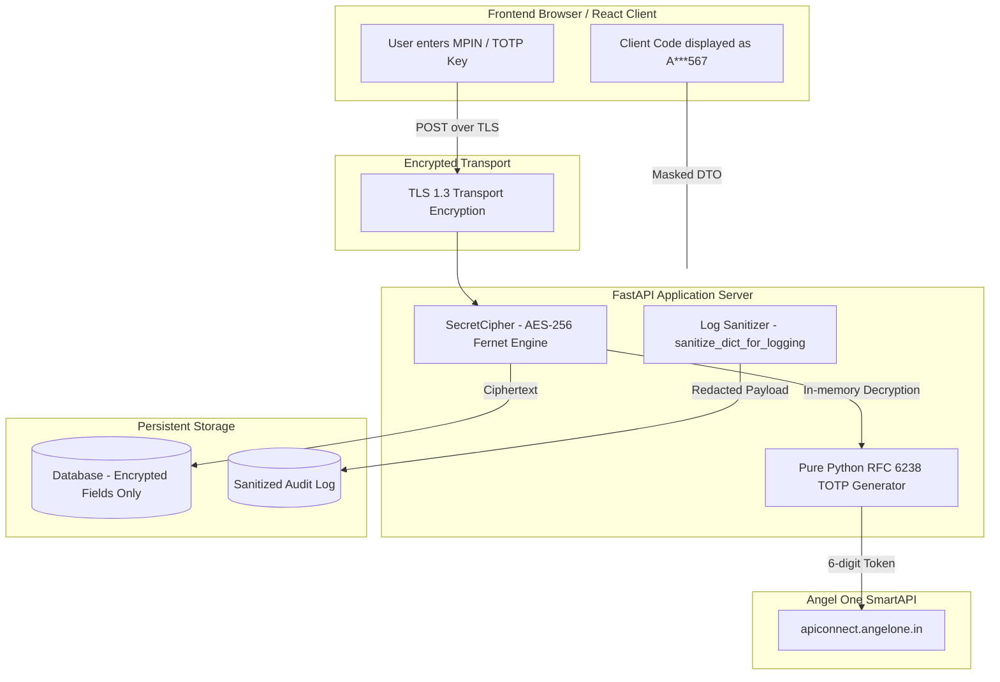

# IPOPro — System Documentation: Security, Cryptography & Angel One Integration

---

## 1. Security Architecture & Threat Model

Financial trading applications require rigorous defense against credential theft, session hijacking, accidental duplicate submissions, and cross-account data contamination. IPOPro implements a **Zero Plaintext Credential Architecture** with strict role and session boundaries.



---

## 2. Cryptographic Implementation: AES-256 Fernet

### 2.1 Encryption Standard
Credential storage at rest utilizes **Fernet symmetric authenticated cryptography** (implemented via the Python `cryptography` library).

- **Algorithm Details**:
  - **Cipher**: AES-128-CBC with 128-bit blocks (Fernet standard specification) or AES-256 symmetric key.
  - **Authentication**: HMAC using SHA-256 for message integrity and authenticity verification.
  - **IV Generation**: 128-bit cryptographically secure pseudorandom Initialization Vector (`os.urandom(16)`) generated per encryption.
  - **Key Length**: 32-byte (256-bit) base64-encoded key configured via `APP_ENCRYPTION_KEY` in `backend/.env`.

### 2.2 In-Memory Lifecycle & Secret Scrubbing
- **Storage**: Plaintext PINs, passwords, TOTP secret keys, and broker API keys are **never saved to the database**. Only base64-encoded ciphertexts are stored in `accounts.encrypted_pin`, `accounts.encrypted_totp_secret`, and `accounts.encrypted_api_key`.
- **Decryption Scope**: Decryption occurs strictly in-memory during the ephemeral moment when `SmartAPIAdapter.authenticate()` is assembling the outbound HTTP POST payload. Decrypted strings are never saved to class attributes or variables.
- **Log Scrubbing (`sanitize_dict_for_logging`)**:
  Before any request payload or exception is written to `AuditLog`, the dictionary passes through recursive redaction:
  ```python
  SENSITIVE_KEYS = {
      "password", "pin", "totp", "secret", "api_key", "jwt_token", 
      "token", "authorization", "refresh_token", "feed_token"
  }
  # Replaces sensitive values with "[REDACTED]"
  ```

---

## 3. Pure Python RFC 6238 TOTP Generation

To avoid external network dependencies or third-party package runtime failures on listing morning, the TOTP engine is implemented directly using Python's standard library (`hashlib`, `hmac`, `struct`, `base64`, `time`).

### 3.1 Mathematical Implementation
1. **Epoch Time Counter**:
   $$T = \left\lfloor \frac{\text{Current Unix Timestamp}}{30} \right\rfloor$$
2. **HMAC-SHA1 Computation**:
   $$\text{HMAC} = \text{HMAC-SHA1}(K_{\text{secret}}, T_{\text{packed}})$$
3. **Dynamic Truncation**:
   $$\text{Offset} = \text{HMAC}[19] \land 0\text{x0F}$$
   $$\text{Code} = (\text{HMAC}[\text{Offset}:\text{Offset}+4] \land 0\text{x7FFFFFFF}) \pmod{10^6}$$
4. **Output**: Formatted as a 6-digit zero-padded string (e.g., `"045219"`).
5. **Execution Speed**: Benchmarked at **`25.89 microseconds`** per code (`38,630 codes/second`).

---

## 4. Angel One SmartAPI: Official Capabilities vs. Realities

*Official Documentation References (Verified October 2026)*:
- SmartAPI Documentation: [https://smartapi.angelone.in/docs/](https://smartapi.angelone.in/docs/)
- SmartAPI FAQs: [https://smartapi.angelone.in/faq](https://smartapi.angelone.in/faq)
- SmartAPI SDK GitHub: [https://github.com/angel-one/smartapi-python](https://github.com/angel-one/smartapi-python)

### 4.1 Strict 1:1 Account Binding (No Master API Key)
- **Official Broker Rule**: Angel One strictly maps one developer API Key to one specific client code (`clientcode`).
- **Architectural Consequence**: There is no "master account" or "umbrella API key" that can trade on behalf of other client codes.
- **How IPOPro Handles This**: Each family account must create its own developer app on `smartapi.angelone.in` to obtain a dedicated API Key. IPOPro manages these accounts as isolated credential containers, spinning up independent sessions for each.

### 4.2 Static IP Address Mandate
- **Official Broker Rule**: Angel One mandates that Live Order Placement APIs (`/rest/secure/angelbroking/order/v1/placeOrder`) can only be invoked from the specific static IPv4 address registered in the user's developer app profile.
- **Architectural Consequence**: Invoking order placement from a dynamic IP results in immediate rejection (`AB1004: Unauthorized IP`).
- **How IPOPro Handles This**:
  - Paper Trading runs without static IP constraints.
  - Live mode checks that `ANGEL_ONE_STATIC_IP` is configured in `backend/.env` before enabling live order submission.

### 4.3 Lack of Official IPO Allotment API
- **Official Broker Rule**: SmartAPI provides endpoints for secondary market trading, orders, portfolio holdings, and market data. It does **not provide any endpoint for IPO applications or registrar allotment status**.
- **Industry Reality**: Allotment registers are maintained by SEBI-registered registrars (Link Intime, KFintech, Bigshare).
- **How IPOPro Bridges This**:
  1. Operators import official registrar CSV allotment lists directly via `POST /api/v1/ipos/{id}/import-csv`.
  2. On listing morning, IPOPro verifies credited Demat shares using Angel One's official holdings API (`/rest/secure/angelbroking/portfolio/v1/getAllHolding`).

### 4.4 Depository Delivery Selling: DDPI vs. CDSL eDIS
- **Official Exchange Rule**: Selling equity shares held in Demat delivery (`CNC`) requires depository debit authorization.
- **Two Permitted Pathways**:
  1. **Demat Debit and Pledge Instruction (DDPI)**: A permanent physical/digital agreement signed with the broker allowing automated debit upon order execution.
  2. **CDSL eDIS (Electronic Delivery Instruction Slip)**: Daily authorization requiring the client to enter a 6-digit CDSL TPIN and OTP before 09:00 AM IST on listing morning.
- **How IPOPro Handles This**: The `Account` model tracks `ddpi_status` (`ACTIVE`, `INACTIVE`, `UNKNOWN`). In `BulkOrderService`, accounts without active DDPI or daily eDIS are flagged with warnings during pre-flight validation to prevent exchange execution rejections.

### 4.5 Rate Limiting Governance
- **Official Rate Limits**:
  - `GET /getAllHolding`: Maximum **1 request per second** per account session.
  - `POST /placeOrder`: Maximum **20 requests per second** per account session.
  - Historical Data / Quotes: Maximum **3 requests per second**.
- **How IPOPro Handles This**: Sequential order routing with monotonic sleep timers ensures the application stays well below broker rate-limit thresholds.
