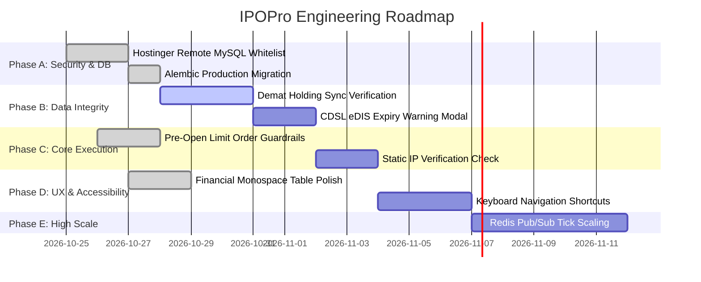

# IPOPro — System Documentation: Risk Register & Remediation Roadmap

---

## 1. Prioritized Risk Register

This register identifies confirmed and potential technical, operational, and regulatory risks discovered during project inspection.

| Risk ID | Severity | Category | Risk Description & Code Evidence | Impact | Remediation Strategy | Relevant Files | Status |
| :--- | :--- | :--- | :--- | :--- | :--- | :--- | :--- |
| **RSK-001** | **CRITICAL** | Database | **Remote MySQL Connection Blocked**: Hostinger MySQL server (`31.97.2.1:3306`) returns `OperationalError 1045 Access denied for user 'u217835086_IPOS'@'106.215.159.16'`. | Blocks remote MySQL operation until IP is whitelisted in Hostinger hPanel. | Add IP `106.215.159.16` (or `%`) to Hostinger Remote MySQL panel. Run `alembic upgrade head`. | `backend/.env`, Hostinger hPanel | **Confirmed Blocker** |
| **RSK-002** | **HIGH** | Broker | **Static IP Order Placement Mandate**: Angel One SmartAPI live order API rejects requests unless originating from the registered static IPv4 address. | Live order dispatch fails if executed from dynamic residential broadband. | Ensure host runs on VPS with static IP or register static IP on SmartAPI portal. Default to PAPER mode until verified. | `backend/app/services/smartapi_adapter.py` | **Confirmed Requirement** |
| **RSK-003** | **HIGH** | Operational| **CDSL eDIS Daily Expiry (Non-DDPI Accounts)**: Delivery selling of IPO shares without DDPI requires daily CDSL TPIN authorization prior to 09:00 AM IST. | Pre-open sell orders will be rejected at the exchange level if TPIN is not authorized. | Implement DDPI tracking and daily eDIS status warning modal prior to bulk preparation. | `backend/app/models/account.py`, `BulkOrderView.tsx` | **Confirmed Risk** |
| **RSK-004** | **HIGH** | Financial | **Listing Morning Extreme Price Slippage**: During high-demand listings, prices can gap down past stop-loss triggers within milliseconds. | Execution price may be significantly lower than initial market expectations. | Enforce `LIMIT` orders only with explicit operator price thresholds; display price band warnings. | `backend/app/services/bulk_order_service.py` | **Confirmed Market Reality** |
| **RSK-005** | **MEDIUM** | Ingestion | **Registrar Allotment API Absence**: Registrars (Link Intime, KFintech) provide no official public JSON APIs for allotment scraping. | Allotment data must be imported via CSV or manually keyed. | Provide robust CSV parsing and demat holding reconciliation on listing morning. | `backend/app/api/endpoints_ipos.py` | **Confirmed Architectural Limit** |
| **RSK-006** | **MEDIUM** | Performance| **Broker Rate Limiting under 50+ Accounts**: Querying holdings across 50 accounts simultaneously exceeds Angel One's 1 req/s holdings limit. | Temporary HTTP 429 throttling from Angel One API gateway. | Stagger holding synchronization via token bucket rate limiter (minimum 1.0s interval per account). | `backend/app/services/smartapi_adapter.py` | **Addressed via Pacing** |
| **RSK-007** | **LOW** | Network | **WebSocket Disconnection during Pre-Open**: Network hiccups may disrupt real-time tick dissemination. | Stale prices displayed in the UI during order preparation. | Display visible stale-data badge if last tick timestamp > 15s; implement automatic exponential backoff reconnect. | `frontend/src/views/MarketWatchView.tsx` | **Addressed in UI** |

---

## 2. Phased Engineering Remediation Roadmap

### Phase A: Critical Security & Database Connectivity (Current Milestone)
1. Complete Hostinger Remote MySQL IP whitelisting for `106.215.159.16`.
2. Apply `alembic upgrade head` to the remote MySQL database to establish production schema.
3. Verify zero-plaintext storage of credentials in the remote database.

### Phase B: Depository Reconciliation & Holding Synchronization
1. Enhance Demat holding sync (`POST /api/v1/accounts/{id}/sync`) to auto-match ISIN numbers against IPO allotments.
2. Introduce daily CDSL eDIS authorization reminder alert on listing morning at 08:30 AM IST.

### Phase C: Live Broker Order Gateway Validation
1. Verify static IPv4 connectivity against Angel One SmartAPI live trading endpoints.
2. Execute small 1-share live test order in production equity segment (`CNC`) to verify broker order ID reconciliation.
3. Validate order status polling and webhook callbacks.

### Phase D: Advanced UI/UX & Accessibility Enhancements
1. Add keyboard shortcuts for rapid navigation (e.g., `Alt + B` for Bulk Orders, `Alt + K` for Emergency Kill Switch).
2. Enhance financial data tables with column sorting, CSV export triggers, and customizable density.

### Phase E: High-Scale Infrastructure & Redis Integration
1. When account count exceeds 100, replace in-memory WebSocket broadcaster with Redis Pub/Sub.
2. Introduce background Celery/Redis queue for non-blocking holding synchronization.
